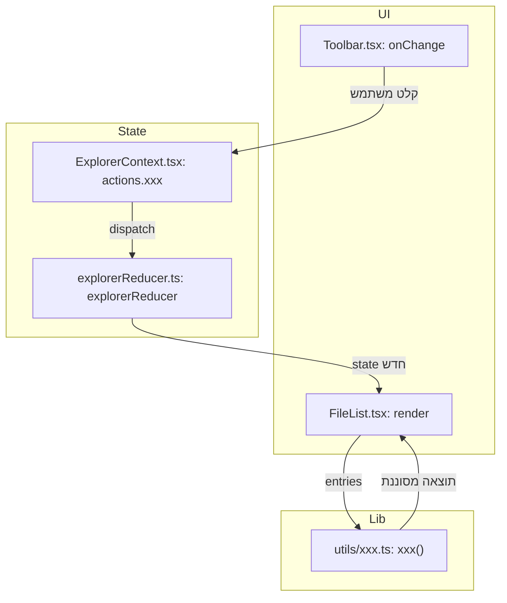

# trace-feature – מעקב אחרי יכולת מקצה לקצה

היכולת לחקירה: **$ARGUMENTS**

אם לא צוינה יכולת – לשאול את המשתמש איזו יכולת לחקור, ולא לנחש.

## כללי יסוד

- **קריאה בלבד.** אסור לשנות, ליצור או למחוק קבצים כלשהם בפרויקט. זהו Skill של חקירה בלבד.
- **רק עובדות מאומתות.** כל נתיב קובץ, שם פונקציה, קומפוננטה, hook, action או type שמופיע בדוח חייב להיות כזה שנקרא בפועל בקוד במהלך החקירה. אסור להמציא שמות או לנחש מבנה.
- כל הפניה לקוד תיכתב בפורמט `path/to/file.ts:line` (נתיב יחסי לשורש הפרויקט), כדי שיהיה אפשר ללחוץ עליה.
- אם משהו לא ברור או לא נמצא – לכתוב זאת במפורש בדוח ("לא נמצא", "לא ודאי"), ולא להשלים מהדמיון.
- הדוח נכתב בעברית. באנגלית רק שמות קבצים, פונקציות ומונחים טכניים.

## מפת הארכיטקטורה של הפרויקט (נקודת התחלה – לאמת מול הקוד)

| שכבה | מיקום | תפקיד |
|------|--------|--------|
| כניסה | `src/main.tsx`, `src/App.tsx` | אתחול React, הרכבת ה-layout הראשי |
| ממשק | `src/components/*.tsx` | קומפוננטות UI (Toolbar, FileList, Sidebar, DetailsPane, StatusBar...) |
| Hooks | `src/components/use*.ts` | לוגיקה אסינכרונית צמודת-UI (למשל `useLineCounts`) |
| State | `src/state/ExplorerContext.tsx`, `src/state/explorerReducer.ts` | `ExplorerProvider`, `useExplorer`, `ExplorerActions`, `explorerReducer`, `ExplorerAction` |
| גישה לקבצים | `src/lib/fileSystem.ts`, `src/lib/BrowserFileSystemAdapter.ts` | הממשק `FileSystemAdapter` והמימוש מעל File System Access API |
| מודלים | `src/lib/models/*.ts` | טיפוסים (`FileSystemEntry`, `FolderRef`, מיון) |
| כלי עזר | `src/lib/utils/*.ts` | לוגיקה טהורה (חיפוש, סינון, מיון, פורמט, ספירת שורות...) |
| מטא-דאטה | `src/lib/metadata.ts`, `src/lib/exifTags.ts` | חילוץ פרטי קבצים |
| עיצוב | `src/styles/*.css` | tokens ו-layout |
| בדיקות | `**/*.test.ts(x)` | Vitest + Testing Library |
| תיעוד תרגילים | `promt/*.md` | פרומפטים של תרגילים קודמים – עשויים לתאר את כוונת היכולת |

המפה היא רמז בלבד. אם המבנה בפועל שונה – לפעול לפי הקוד ולציין את הפער.

## שלבי העבודה

### שלב 1 – זיהוי נקודת הכניסה

1. לתרגם את תיאור היכולת למילות מפתח: טקסט בממשק (כולל טקסט בעברית), שמות אפשריים של קומפוננטות, actions, פונקציות ו-CSS classes.
2. לחפש עם `Grep` / `Glob` ב-`src/` (וגם ב-`promt/` וב-`git log --oneline` לקבלת הקשר היסטורי).
3. לאתר את **הטריגר**: אירוע משתמש (`onClick`, `onChange`, `onKeyDown`), טעינה (`useEffect`), או שינוי state – ואת הקומפוננטה שבה הוא מוגדר.
4. אם יש כמה נקודות כניסה (למשל כפתור + קיצור מקלדת) – לתעד את כולן.

### שלב 2 – איתור הקבצים והפונקציות המעורבים

לכל קובץ רלוונטי – **לקרוא אותו בפועל** (`Read`), לא להסתפק בתוצאת חיפוש. לרשום:
- נתיב הקובץ ושורות רלוונטיות.
- הפונקציות / קומפוננטות / hooks / types המעורבים ותפקיד כל אחד.
- האם הוא שכבת UI, state, lib, utils או בדיקות.

### שלב 3 – מעקב אחרי זרימת הביצוע והנתונים

לעקוב צעד-אחר-צעד מהטריגר ועד התוצאה המוצגת למשתמש:
1. **ממשק → state:** איזו פעולה מתוך `ExplorerActions` נקראת, ואיזה `ExplorerAction` נשלח ל-`explorerReducer`.
2. **state:** איך ה-reducer משנה את `ExplorerState`, ואילו selectors (כמו `currentLocation`) גוזרים ממנו ערכים.
3. **lib / מערכת קבצים:** אילו מתודות של `FileSystemAdapter` נקראות, מה הן מחזירות, ואיך מטופלות שגיאות (`FsError` והקודים שלו).
4. **utils:** אילו פונקציות טהורות מעבדות את הנתונים (סינון, מיון, פורמט וכו').
5. **חזרה לממשק:** איך הנתונים המעובדים מגיעים לקומפוננטה ומוצגים (props, context, re-render).

לכל צעד לציין: **מה נכנס** (קלט/טיפוס), **מה יוצא**, ו**איפה** (`file:line`).
לשים לב במיוחד ל: קוד אסינכרוני (`async`/`await`, Promises), ביטול/race conditions, memoization (`useMemo`, `useCallback`), ומקרי קצה (תיקייה ריקה, אין הרשאה, דפדפן לא נתמך).

### שלב 4 – זיהוי תלויות בין רכיבים

- תלויות import ישירות בין הקבצים המעורבים.
- תלויות דרך context (`useExplorer`) ודרך props.
- תלויות ב-API של הדפדפן (File System Access API ואחרים).
- רכיבים אחרים שמשתמשים באותו קוד – כלומר מה עלול להיפגע אם משנים את היכולת.
- בדיקות קיימות שמכסות את היכולת (קבצי `*.test.ts(x)`), ומה **לא** מכוסה.

### שלב 5 – כתיבת הדוח

להציג למשתמש דוח בעברית במבנה הבא:

```markdown
# דוח מעקב: <שם היכולת>

## תקציר
2–4 משפטים: מה היכולת עושה ואיך היא ממומשת בקווים כלליים.

## נקודות כניסה
- <תיאור הטריגר> – `src/components/X.tsx:NN` (`functionName`)

## קבצים ופונקציות מעורבים
| קובץ | פונקציה / רכיב | שכבה | תפקיד |
|------|-----------------|------|--------|
| `src/...:NN` | `name` | UI / state / lib / utils | ... |

## זרימת הביצוע והנתונים
1. ... (`file:line`) – קלט: ..., פלט: ...
2. ...

## תרשים זרימה
(בלוק Mermaid – ראו שלב 6)

## תלויות
- **פנימיות:** ...
- **חיצוניות / API של הדפדפן:** ...
- **רכיבים שעלולים להיות מושפעים משינוי:** ...

## טיפול בשגיאות ומקרי קצה
- ...

## כיסוי בדיקות
- קיים: `...test.ts` – מה נבדק
- חסר: ...

## הערות ונקודות לא ודאיות
- ...
```

### שלב 6 – תרשים זרימה ב-Mermaid

לכלול בדוח בלוק ```` ```mermaid ```` אחד לפחות:
- להשתמש ב-`flowchart TD` לזרימה הכללית. אם יש אינטראקציה אסינכרונית מורכבת בין כמה רכיבים – אפשר להוסיף גם `sequenceDiagram`.
- כל צומת מייצג רכיב/פונקציה **אמיתיים** מהקוד, והתווית כוללת את שם הפונקציה ואת שם הקובץ (למשל `FileList.tsx: handleClick`).
- החצים מתויגים בנתון או בפעולה שעוברים (למשל `|dispatch SET_QUERY|`).
- להבחין בין השכבות באמצעות `subgraph` (UI / State / Lib).
- לעטוף תוויות שמכילות תווים מיוחדים או עברית במירכאות כפולות (`A["טקסט"]`) כדי שהתרשים יתרנדר תקין.
- לבדוק שהתחביר תקין: מזהי צמתים באנגלית בלי רווחים, סוגריים מאוזנים, אין `end` כמזהה צומת.

דוגמה למבנה (להחליף בשמות האמיתיים שנמצאו):



### שלב 7 – בדיקה עצמית לפני הצגת הדוח

לפני שמציגים את הדוח, לוודא:
- [ ] כל נתיב בדוח קיים (נבדק עם `Glob`/`Read`).
- [ ] כל שם פונקציה/רכיב מופיע בפועל בקובץ שאליו הוא משויך.
- [ ] מספרי השורות תואמים לקוד הנוכחי.
- [ ] תרשים ה-Mermaid תואם לזרימה שתוארה בטקסט, ותחבירו תקין.
- [ ] לא שונה אף קובץ בפרויקט.
