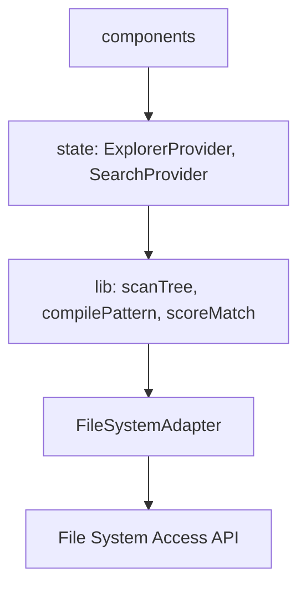
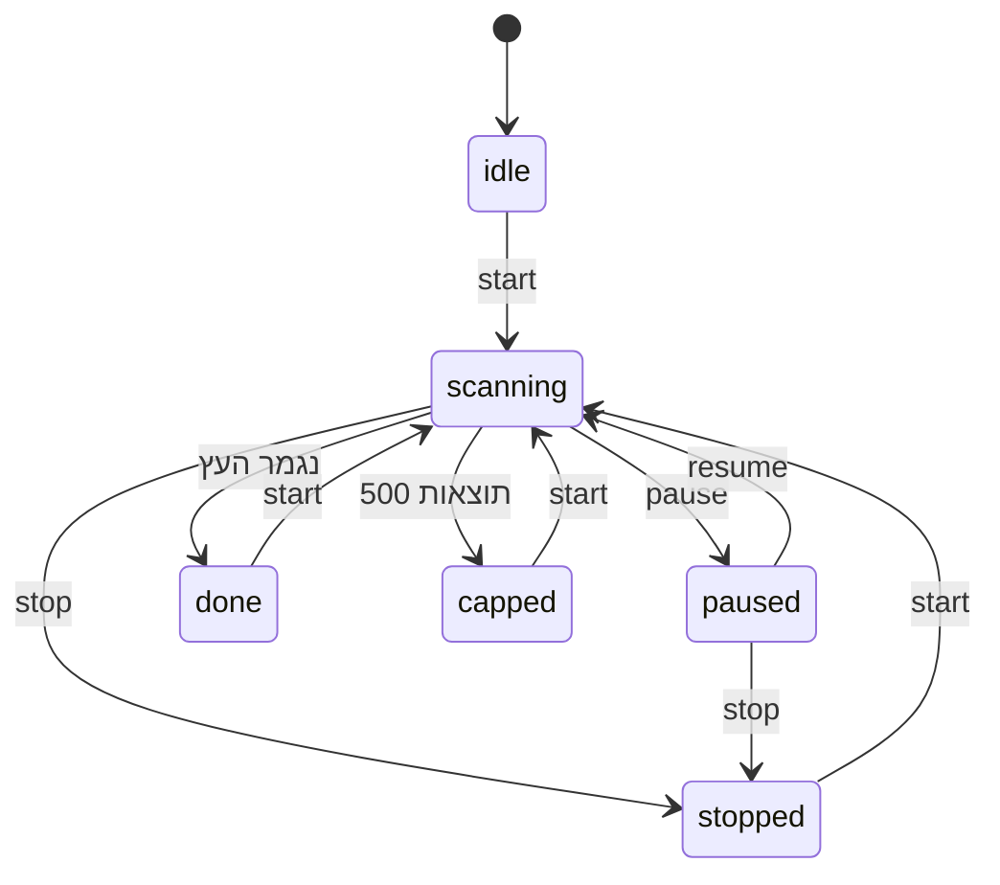

# Architecture Spine — חיפוש מתקדם

## Design Paradigm

**צינור אסינכרוני טהור + כותב יחיד לכל מצב.** הסריקה היא `AsyncGenerator` חסר React ב-`lib/`; המצב מנוהל בשני reducers טהורים, ולכל אחד שדות משלו.

| שכבה | מיקום | תפקיד |
| --- | --- | --- |
| lib (טהור) | `src/lib/` | `scanTree`, `compilePattern`, `scoreMatch`, `SKIP_DIRS` |
| state | `src/state/` | `explorerReducer` (ניווט), `searchReducer` + `SearchProvider` (חיפוש) |
| UI | `src/components/` | `SearchBox`, `SearchResults`, צרכנים של `useSelectedEntry()` |



כיוון התלות חד-כיווני: UI ← state ← lib ← Adapter. `lib/` לא מייבא מ-`state/` או מ-`components/`.

## Invariants & Rules

### AD-1 — סריקה כמחולל טהור [ADOPTED] · מתודת Adapter קלה [ADOPTED]

- **Binds:** FR-6..FR-12, FR-24, SM-1..SM-3
- **Prevents:** סריקה בתוך reducer או קומפוננטה, שני מנגנוני ביטול, Worker מיותר; עיכוב התוצאה הראשונה בגלל `getFile()` לכל קובץ
- **Rule:** `scanTree(adapter, root, compiled, signal)` הוא `AsyncGenerator<SearchResult>` ב-`src/lib/`, ללא React וללא Worker. `listEntries` הקיים קורא `getFile()` לכל קובץ, ולכן ה-Adapter מקבל מתודה קריאה-בלבד אחת, `listNames(folder)`, שמחזירה שם, סוג ומזהה בלבד. גודל ותאריך נטענים רק לתוצאות (עד 500). אין מתודות נוספות.

### AD-2 — סדר BFS ותוצאה אחת ל-yield [ADOPTED]

- **Binds:** FR-7, FR-17
- **Prevents:** DFS שמפר "קרוב קודם"; אצוות שונות בין יחידות
- **Rule:** תור תיקיות לפי רמות. כל `yield` מחזיר תוצאה אחת. `SearchResult = { entry, parent: FolderRef, depth, score }`; `depth` של פריט ישיר במיקום הנוכחי הוא 1.

### AD-3 — השהיה, עצירה ויציאה [ADOPTED]

- **Binds:** FR-8, FR-9, FR-24, FR-25
- **Prevents:** דגל השהיה בתוך הסריקה; תוצאות שמגיעות אחרי עצירה; ריצה שממשיכה ברקע
- **Rule:** השהיה = `useSearch` אינו קורא ל-`next()` הבא כשהסטטוס `paused`. תוצאה שחזרה מ-`next()` שכבר בדרך בזמן השהיה **נשמרת**. עצירה וביטול = `AbortController` + `return()`, ונכנסים לתוקף ב-`next()` הבא; תוצאה שחזרה אחרי עצירה או ביטול **נזרקת**. יציאה מ-`Location` מסוג `search` בזמן `scanning` ממירה את הסטטוס ל-`paused`. אפשר `resume` רק מ-`paused`; מ-`stopped`, `done` ו-`capped` רק `start` חדש.

### AD-4 — מודול דפוס יחיד [ADOPTED]

- **Binds:** FR-1..FR-5, FR-15, FR-17, FR-22
- **Prevents:** שני מפרשי דפוס; ציון שנגזר בנפרד מההתאמה; קומפילציה לכל קובץ; קריסת RegExp מתו מיוחד
- **Rule:** `compilePattern(raw)` נקרא פעם אחת לחיפוש ומחזיר `{ nameRe, extension|null, fixedChars }`. כל תו שאינו `*` או `?` עובר בריחה ל-RegExp. סיומת מוגדרת רק לפי צורת הדפוס (`*.xxx`, `שם*.xxx`), לא לפי שם הפריט. `scoreMatch(compiled, entry, depth)` מחזיר `number | null` (`null` = אין התאמה), והציון מעוגל ב-`Math.round`, שלם 0..95. נוסחת הקרבה והקנס חיות רק שם. `nameSearch.ts` הישן ופעולת ה-reducer `search` נמחקים; אין סינון מיידי של התיקייה בזמן ה-debounce (החלטת משתמש, שינוי התנהגות מכוון).

### AD-5 — חיפוש כ-Location והפעלה יחידה [ADOPTED]

- **Binds:** FR-19..FR-21
- **Prevents:** מנגנון "אחורה" כפול; cache לכל חיפוש; הפעלה כפולה (כולל StrictMode); forward ישן אחרי replace
- **Rule:** `Location` מקבל `{ type: 'search', root: FolderRef, pattern: string }`, ו-`sameLocation` משווה `root.id` ודפוס מנורמל (`trim` + אותיות קטנות). חיפוש נוצר רק כשהמיקום הנוכחי הוא `folder`; ב-`home`, `pc` ו-`quick` תיבת החיפוש מושבתת. התוצאות חיות רק ב-`searchReducer`, וסשן אחד (האחרון) שומר אותן. **אפקט יחיד** ב-`SearchProvider` מפעיל סריקה כשה-`Location` הנוכחי הוא `search` ואין סשן תואם; הוא קורא ל-`runSearch` פנימי שאינו נוגע בהיסטוריה. `start` בזמן שעומדים על `search` מחליף את הרשומה (`replace`) וחותך את ה-forward. כשל בקריאת השורש מסיים את הסריקה כ-`done` עם אפס תוצאות.

### AD-6 — כותב יחיד, שער ניווט יחיד וניקוי [ADOPTED]

- **Binds:** all
- **Prevents:** שני כותבים לאותו שדה; סשן חי אחרי ניווט; debounce שיורה אחרי ניווט
- **Rule:** `explorerReducer` כותב רק היסטוריה, בחירה ועץ; `searchReducer` כותב רק את `SearchSession`. ה-UI מתחיל חיפוש אך ורק דרך `search.start(pattern)`. כל ניווט עובר בשער `goTo(location, { origin })`. `origin: 'user'` (עץ, breadcrumbs, up, sidebar, `pickFolder`, ניקוי התיבה, refresh) מנקה את הסשן, מבטל את ריצתו (`abort`) ומבטל debounce תלוי, באופן אטומי. `origin: 'result'` (מעבר למיקום, FR-19) אינו מנקה. back ו-forward אינם מנקים. ניקוי התיבה מנווט לתיקיית ה-`root` של החיפוש.

### AD-7 — תצוגה ובחירה [ADOPTED]

- **Binds:** FR-14, FR-18, FR-19, FR-26
- **Prevents:** `DetailsPane` ריק בתוצאות; ענפי "אם חיפוש" ב-`FileList`; סימון שנמחק אחרי מעבר למיקום
- **Rule:** תוצאות מוצגות ב-`SearchResults` נפרד. מקור הפריט הנבחר הוא `useSelectedEntry()`, ומקור הרשימה לסיכומים הוא `useVisibleEntries()`; `DetailsPane` ו-`StatusBar` קוראים רק להם. `selection` נשאר שדה של `explorerReducer`, ומזהי פריט (`parent.id/name`) ייחודיים גלובלית. `navigate` מקבל `select?: id` ש-`enter()` מיישם. `App`, `Breadcrumbs`, `FileInfo`, `up` ו-`refresh` מטפלים ב-`Location` מסוג `search`.

### AD-8 — תקרה, דילוג ושגיאות [ADOPTED]

- **Binds:** FR-10..FR-12, SM-C1, FR-22
- **Prevents:** תקרה מפוזרת; דילוג שקט שאינו מתועד; בקשת הרשאה באמצע סריקה; כתיבה לדיסק
- **Rule:** תקרת 500 נאכפת רק בצרכן, שסופר ועוצר את המחולל (סטטוס `capped`). `scanTree` תופס `FsError` מסוג `permission` ו-`not-found` לכל תיקייה בנפרד ודולג בשקט; סריקה לא מציגה בקשת הרשאה, ותיקייה שדורשת אותה נחשבת `permission`. `SKIP_DIRS` הוא קבוע יחיד ב-`lib/` (`node_modules`, `.git`). אין כתיבה, מחיקה או קריאות רשת.

### AD-9 — זהות ריצה [ADOPTED]

- **Binds:** FR-8, FR-24, FR-20
- **Prevents:** תוצאה מריצה ישנה שנכנסת לסשן הלא נכון
- **Rule:** כל `start` או `runSearch` מקבל `runId` עולה. כל action של הסריקה נושא את ה-`runId`, וה-reducer מתעלם מ-action שה-`runId` שלו שונה מזה שבסשן. ניקוי סשן מבצע גם `abort`.

### AD-10 — צורת הסשן ומיון [ADOPTED]

- **Binds:** FR-16, FR-25, FR-20
- **Prevents:** שלושה בעלים ל-`pattern`; שני בעלים לסדר התוצאות
- **Rule:** `SearchSession = { runId, root, pattern, status, results, count, sortedByScore }` הוא הבעלים היחיד של הדפוס; טקסט התיבה הוא טיוטה מקומית בלבד. סדר התוצאות הוא סדר ההגעה, ו-`explorerReducer.sort` אינו חל עליהן. מיון קרבה הוא הדגל `sortedByScore` ותצוגה נגזרת (מיון יציב, שוויון לפי `depth`), פעיל רק כשהסטטוס אינו `scanning`.

## Consistency Conventions

| Concern | Convention |
| --- | --- |
| Naming | פעולות reducer ב-camelCase באנגלית; קבצי lib ב-camelCase; בדיקות `*.test.ts` לצד הקוד |
| Data & formats | `id` של פריט = `parent.id/name`; `score` שלם 0..95; `depth` מתחיל ב-1 |
| State & cross-cutting | שינוי מצב רק דרך reducer; כל ניווט דרך `goTo`; `debounce` 300ms ב-hook של התיבה; שגיאות מערכת קבצים כ-`FsError` |
| Verification | `npm run check` אחרי כל שינוי; בדיקת ביצועים ל-SM-1/SM-2 על עץ של כ-10,000 קבצים |

## Stack

ratified מהקוד הקיים; אין תלות חדשה.

| Name | Version |
| --- | --- |
| React | ^19.2.8 |
| TypeScript | ~6.0.2 |
| Vite | ^8.3.0 |
| Vitest | ^4.0.0 |
| oxlint | ^1.81.0 |
| Node | 20+ |

## Structural Seed

```text
src/
  lib/
    scanTree.ts            # AD-1..AD-3, AD-8
    fileSystem.ts          # +listNames (AD-1)
    utils/pattern.ts       # AD-4 (מחליף nameSearch.ts)
    models/entry.ts        # Location מורחב (AD-5)
  state/
    explorerReducer.ts     # +replace, +select ב-navigate
    searchReducer.ts       # AD-6
    SearchProvider.tsx     # useSearch, useSelectedEntry
  components/
    SearchBox.tsx          # בשורת הכתובת (FR-13)
    SearchResults.tsx      # AD-7
```

**נקודות מגע קיימות שיש להתאים (blast radius):** `FileList.tsx` (`SearchBox` מקומי, `searchQuery`, `filterByName`), `StatusBar.tsx`, `DetailsPane.tsx`, `App.tsx`, `Breadcrumbs.tsx`, `FileInfo.tsx`, `enter()` ו-`refresh` ב-`explorerReducer.ts`, ובדיקות `nameSearch.test.ts`, `FileSearch.test.tsx`, `explorerReducer.test.ts`. `SearchBox` המקומי ב-`FileList` מוחלף בקובץ המשותף.

**סביבה:** אפליקציית Web סטטית, Chrome/Edge בלבד, בלי Backend ובלי CI; Node 20+ לפי AGENTS.md (אין `engines` ב-`package.json`).



## Capability → Architecture Map

| Capability / Area | Lives in | Governed by |
| --- | --- | --- |
| התאמת דפוסים (FR-1..5) | `lib/utils/pattern.ts` | AD-4 |
| סריקה והדרגתיות (FR-6..12, 24, 25) | `lib/scanTree.ts`, `SearchProvider` | AD-1, AD-2, AD-3, AD-8 |
| תצוגת תוצאות וקרבה (FR-13..17, 23) | `SearchResults`, `SearchBox` | AD-4, AD-7 |
| פעולה וניווט (FR-18..21, 26) | `explorerReducer`, `useSelectedEntry` | AD-5, AD-6, AD-7 |
| אי-שבירה (FR-22) | כל השכבות | AD-4, AD-8 |

## Deferred

- נוסחת הקרבה המדויקת: ב-`addendum.md` של ה-PRD, ולא החלטה ארכיטקטונית.
- וירטואליזציה של הרשימה: רק אם 500 שורות יתבררו כאיטיות.
- הוספת `engines` ל-`package.json` ואימות Node 20+ מול Vite 8: מחוץ להיקף החיפוש.
- dispatch לכל תוצאה: `[ASSUMPTION]` שמאומת מול SM-1 ו-SM-2.
